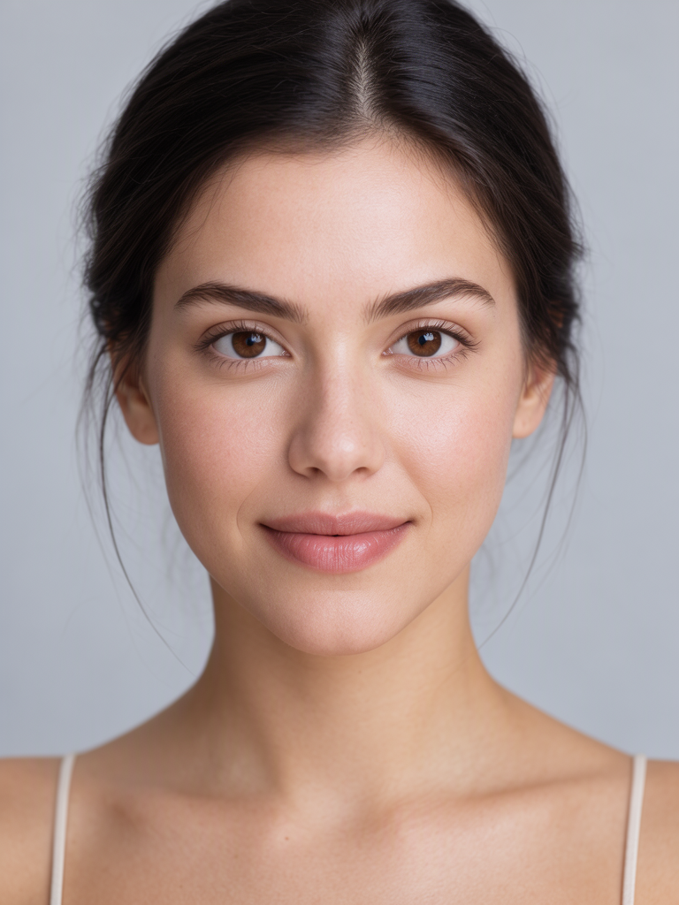
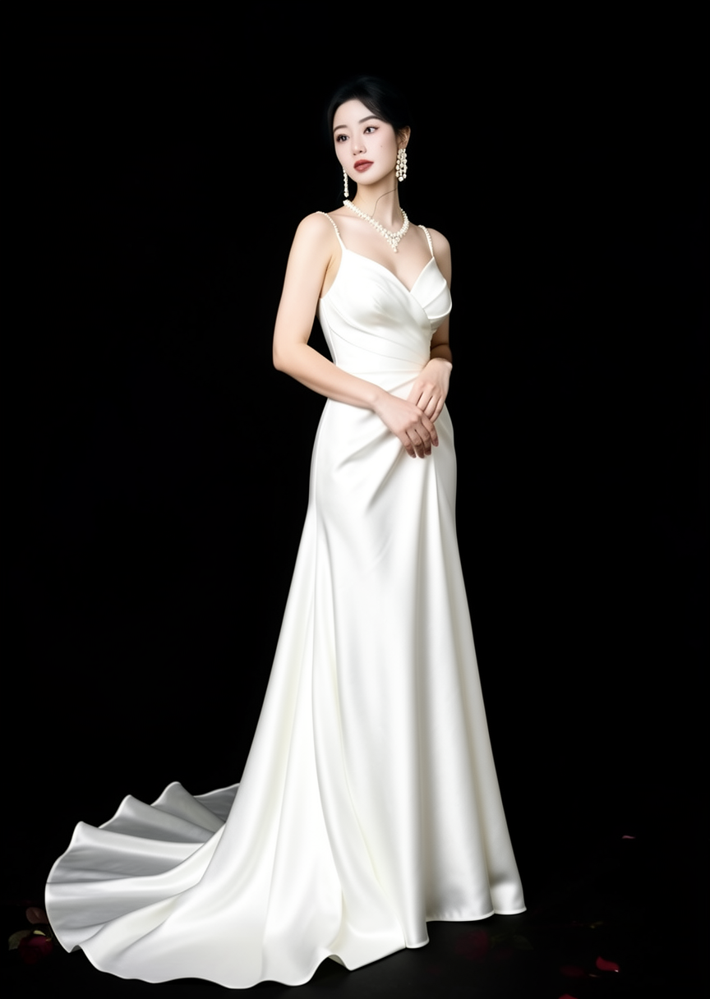
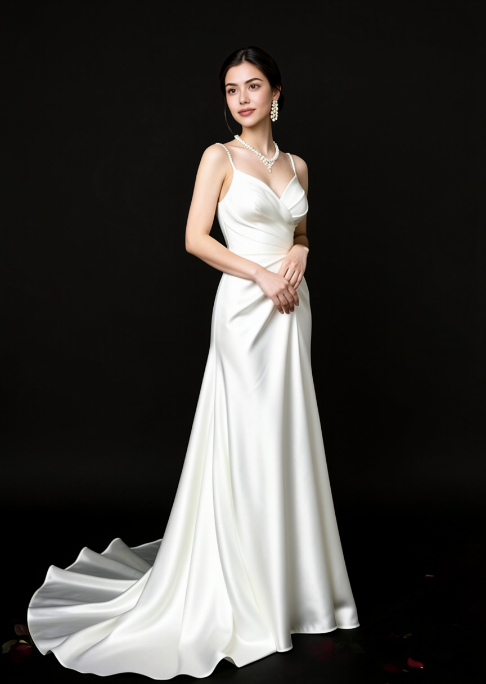

# moss-qwen-faceswap

> **MOSS 出身体图 + Qwen-Image-2.1 BFS 换头 LoRA 换脸 + 手部局部重绘 + 4x 超分**
> 带 Gradio 图形控制台。本机实测相似度 **0.783**（1536×2048），全流程可复现。

---

## ⚠️ 使用红线（务必先读）

**本项目仅限用于：AI 生成的虚拟图源之间的换装、换脸、风格化，以及你本人已获得明确授权的图像。**

**严禁**用于以下任何用途：

- ❌ 未经他人同意，把**真实人物**的脸换到其他图像上（侵犯肖像权、隐私权）
- ❌ 生成、传播用于欺骗、诽谤、骚扰、敲诈的内容（深度伪造）
- ❌ 生成涉及未成年人的任何性化内容
- ❌ 生成裸露、性化、暴力或其他违法内容
- ❌ 冒充他人身份进行诈骗、虚假宣传、伪造证据
- ❌ 任何违反你所在国家/地区法律法规的用途

**使用者须自行承担全部法律责任。** 作者不对任何滥用行为负责。若你不确定自己的用途是否合规，请勿使用。

示例图中的所有人物均为 **AI 生成的虚构人物**，与任何真实人物无关。

---

## 一、为什么需要这套链路

### 核心结论（实测）

| 事实 | 说明 |
|---|---|
| **MOSS 不能换脸** | MOSS-Image-SFT 是纯文生图模型，`pipeline_moss_image.py` 的 `__call__` 没有 image/strength 参数 |
| **换脸必须走 Qwen+BFS** | 同一身体图 + 同一脸源：ReActor(inswapper) 只有 **0.216**，Qwen+BFS 达到 **0.783** |
| **脸像素决定上限** | 底图 864×1216 时脸只有 83×109 px 会糊；放大到 1536×2048 让脸变 155×209 px 才够看 |

### 四路方案实测对比

| 方案 | 脸相似度 | 结论 |
|---|---|---|
| MOSS 身体原图（未换脸） | 0.129 | 基准 |
| ReActor inswapper | 0.216 | ❌ 不可用 |
| Qwen+BFS（864×1216 底图） | 0.735 | ✅ 可用 |
| **Qwen+BFS（先放大到 1536×2048）** | **0.783** | ✅ **最佳** |
| 真脸合成 V3（跨照片） | 0.641 | ⚠️ 有接缝 |

> 相似度为 insightface 余弦相似度（同人基准上限约 0.94）

---

## 二、效果示意

| ① 脸源（AI 虚拟人物） | ② MOSS 出的身体图 | ③ 换脸成品 |
|---|---|---|
|  |  |  |

---

## 三、架构

```
┌─────────────────┐      ┌──────────────────────┐      ┌────────────┐
│  MOSS-Image-SFT │ ───> │ Qwen-Image-2.1       │ ───> │ 手部重绘   │ ───> 4x 超分
│  文生图出身体    │      │ + bfs_head LoRA 换脸  │      │ FaceDetailer│
│  :8189          │      │ :8188                │      │ :8188      │
└─────────────────┘      └──────────────────────┘      └────────────┘
                                    ▲
                          ┌─────────┴─────────┐
                          │ Gradio 控制台      │
                          │ :7870             │
                          └───────────────────┘
```

**注意：两个独立的 ComfyUI 安装，不能混用。**

| 端口 | 安装 | 版本 | 职责 |
|---|---|---|---|
| 8188 | ComfyUI portable | v0.37.0 | Qwen 换脸 / 手部重绘 / 超分 |
| 8189 | ComfyUI-MOSS | v0.42.0 | MOSS 文生图 / MOSS 换装编辑 |
| 7870 | Gradio 控制台 | — | 图形界面（推荐入口） |

---

## 四、安装

### 4.1 依赖

```bash
# 8188 侧（ComfyUI portable 自带 python_embeded）
insightface==2.0  onnxruntime==1.30.0  opencv-python  onnx
albumentations  segment_anything  ultralytics  facexlib  scikit-image  scipy  piexif

# 8189 侧 + 控制台
torch>=2.13  diffusers>=0.42  transformers>=5.20  gradio>=6.30
```

### 4.2 ComfyUI 插件

**8188**：
- [ComfyUI-Easy-Use](https://github.com/yolain/ComfyUI-Easy-Use)
- [ComfyUI-KJNodes](https://github.com/kijai/ComfyUI-KJNodes)
- [ComfyUI-ReActor](https://github.com/Gourieff/ComfyUI-ReActor)（本链路不用，但装了他不影响）
- [ComfyUI-Impact-Pack](https://github.com/ltdrdata/ComfyUI-Impact-Pack) ← **手部重绘必需**
- [ComfyUI-Impact-Subpack](https://github.com/ltdrdata/ComfyUI-Impact-Subpack)
- [ComfyUI_VNCCS_Utils](https://github.com/AHEKOT/ComfyUI_VNCCS_Utils)

**8189**：
- `ComfyUI-Moss-Image-Edit`（MOSS 官方 Edit 节点）

### 4.3 模型

| 用途 | 文件名 | 放置目录 | 大小 |
|---|---|---|---|
| Qwen 底模 | `qwen_image_2.1_bf16.safetensors` | `models/diffusion_models/` | ~13.6 GB |
| Qwen 文本编码 | `qwen3vl_8b_bf16.safetensors` | `models/text_encoders/` | ~16.7 GB |
| Qwen VAE | `qwen_image_2.1_vae_bf16.safetensors` | `models/vae/` | ~644 MB |
| **BFS 换头 LoRA** | `bfs_head_v1.1_qwen_2.1.safetensors` | `models/loras/` | ~248 MB |
| 超分 | `4x-UltraSharp.pth` | `models/upscale_models/` | ~64 MB |
| 手部检测 | `hand_yolov8s.pt` | `models/ultralytics/bbox/` | ~22.5 MB |
| 脸部检测 | `face_yolov8m.pt` | `models/ultralytics/bbox/` | ~52 MB |
| SAM | `sam_vit_b_01ec64.pth` | `models/sams/` | ~375 MB |
| MOSS 底模 | `moss_image_sft_bf16.safetensors` | `models/diffusion_models/` | ~9.7 GB |
| MOSS 文本编码 | `qwen3.5_9b_bf16.safetensors` | `models/text_encoders/` | ~18.4 GB |
| MOSS VAE | `flux2-vae.safetensors` | `models/vae/` | ~321 MB |

> ⚠️ **BFS LoRA 必须匹配基模版本**：本链路用 Qwen-Image-2.1（3072 维），必须用 `bfs_head_v1.1_qwen_2.1.safetensors`。
> 误用 2509 版（4096 维）会**静默失效无报错**，日志报 `shape '[4096, 4096]' is invalid for input of size 9437184`。

---

## 五、启动

```powershell
# 1) ComfyUI 8188（Qwen 换脸）
cd /d D:\ComfyUI_windows_portable
.\python_embeded\python.exe -s ComfyUI\main.py --windows-standalone-build --listen 127.0.0.1 --port 8188

# 2) ComfyUI-MOSS 8189
set PYTHONUTF8=1
cd /d D:\MOSS-Image\ComfyUI-MOSS
..\venv\Scripts\python.exe main.py --listen 127.0.0.1 --port 8189

# 3) 图形控制台 7870
set PYTHONUTF8=1
cd /d <本仓库>\scripts
python dsh_studio.py
```

> **`PYTHONUTF8=1` 必带**，否则中文提示词/路径会 GBK 报错。

打开 `http://127.0.0.1:7870`

---

## 六、图形控制台用法

四个页签，每个都是「源图 → 效果预览」并排，提示词直接填：

| 页签 | 作用 |
|---|---|
| ① MOSS 文生图 | 纯文本出图 |
| ② MOSS 换装/编辑 | 上传底图改衣服 |
| ③ **BFS 换脸** | **主链路**：身体源图 \| 脸源图 \| 效果预览 |
| ④ 手部修复 + 超分 | 局部重绘 + 放大 |

页签③ 两种用法：
- **一键**：填「身体图提示词」→ 点「一键出身体图 + 换脸」（约 4 分钟）
- **分步**：点「只出身体图」→ 看效果 → 不满意改提示词重出 → 满意再点「开始换脸」

---

## 七、命令行用法

### ① MOSS 出身体图

用 `workflows/moss_t2i.api.json` 提交到 8189。**手部防护提示词必加**：

```
正面追加：hands relaxed naturally at her sides, five clearly drawn fingers on each hand
负面追加：bad hands, extra hands, three hands, extra arms, extra fingers,
         missing fingers, fused fingers, deformed limbs
```

### ② BFS 换脸

```bash
python scripts/comfy8188.py swap <身体图> <脸源图> [LoRA权重=1.0]
```

脚本会自动：拷图进 8188 的 `input/` → 按底图实际尺寸建空 latent（16 倍数对齐）→ 提交 → 轮询 → 打印产物路径。

**参数（实测最优）**

| 参数 | 值 |
|---|---|
| LoRA | `bfs_head_v1.1_qwen_2.1.safetensors` |
| LoRA 权重 | 1.0 |
| steps / cfg | 30 / 2.5 |
| sampler / scheduler | euler / simple |
| denoise | 1.0 |
| 尺寸 | **跟随底图，不要写死** |

### ③ 手部重绘

```bash
python scripts/limb_fix.py <input文件名> [denoise=0.45] [steps=20] [hand|face]
```
链路：`UltralyticsDetectorProvider(hand_yolov8s)` → `SAMLoader(sam_vit_b)` → `FaceDetailer`（Qwen 重绘）

### ④ 超分

```bash
python scripts/comfy8188.py upscale <input文件名> [倍数=4]
```

### ⑤ 脸源筛选（三维打分）

```bash
python scripts/rank_face_sources.py <照片目录> --top 20 --prefilter 500
```

⚠️ **必须单进程**（`--procs 1`）。多进程时 insightface 模型加载会被吞掉，返回 0 张有效。

**硬门槛**：脸最短边 ≥120 px、det_score ≥0.75。低于此值换出来必糊。

---

## 八、踩坑清单（全部实测）

1. **`httpx.InvalidURL: Invalid port: ':1]'`**
   系统 `NO_PROXY` 含 `[::1]`，httpx 解析崩溃 → `import gradio` 直接失败。脚本开头必须收窄：
   ```python
   for k in ("NO_PROXY","no_proxy"): os.environ[k] = "localhost,127.0.0.1"
   for k in ("HTTP_PROXY","HTTPS_PROXY","ALL_PROXY","http_proxy","https_proxy","all_proxy"):
       os.environ.pop(k, None)
   ```

2. **Gradio `InvalidPathError`**
   默认只允许返回「当前工作目录」或系统临时目录的文件。产物在其他盘时必须
   `launch(allowed_paths=[OUT_DIR, ...])`，否则**图生成成功了界面却报「错误」**。

3. **`SAMLoader` 缺 `device_mode`**
   必填，值 `AUTO` / `Prefer GPU` / `CPU`。漏了报 HTTP 400 `required_input_missing`。

4. **ultralytics 模型必须放 `models/ultralytics/bbox/`**
   `easy ultralyticsDetectorPipe` 的枚举前缀硬编码 `bbox/`、`segm/`，丢在 `models/ultralytics/` 根目录看不见。

5. **MOSS t2i 用错 scheduler 会出纯噪声**
   必须 `scheduler="normal"`。用 `sgm_uniform` 或挂 `ModelSamplingSD3` 都会出噪声。

6. **`python -c` 传中文路径会被 GBK 破坏** → 一律写 `.py` 文件再执行。

7. **PowerShell here-string 写中文脚本会带 BOM** →
   ```powershell
   [System.IO.File]::WriteAllText($p, $code, (New-Object System.Text.UTF8Encoding($false)))
   ```

8. **真脸合成在跨照片场景会失效**
   技能包里的真脸合成能到 0.83，是因为**源图和生成图来自同一张照片**（换装流程）。
   但「AI 生成的身体 + 另一张照片的脸」光照姿态都不同，硬贴会出接缝，相似度反降到 0.641。

---

## 九、脚本说明

| 脚本 | 作用 |
|---|---|
| `dsh_studio.py` | Gradio 四页签控制台 |
| `comfy8188.py` | 8188 提交器（`upscale` / `swap` 子命令） |
| `limb_fix.py` | 手部/四肢局部重绘 |
| `rank_face_sources.py` | 脸源三维打分（脸像素 + 正面度 + 清晰度） |
| `mosaic_faces.py` | 给图中人脸打马赛克（做示例图用） |

---

## 十、致谢

- [MOSS-Image](https://github.com/OpenMOSS/MOSS-Image) — 文生图底模
- [Qwen-Image](https://github.com/QwenLM/Qwen-Image) — 换脸底模
- [ComfyUI](https://github.com/comfyanonymous/ComfyUI)
- [ComfyUI-Impact-Pack](https://github.com/ltdrdata/ComfyUI-Impact-Pack) — 局部重绘
- [ComfyUI-ReActor](https://github.com/Gourieff/ComfyUI-ReActor) — insightface 相关工具
- BFS 换头 LoRA — `bfs_head_v1.1_qwen_2.1.safetensors`

---

## License

MIT（代码部分）。模型权重遵循各自原始许可，请自行查阅。
**再次强调：本项目严禁用于侵犯他人肖像权或任何违法用途。**
